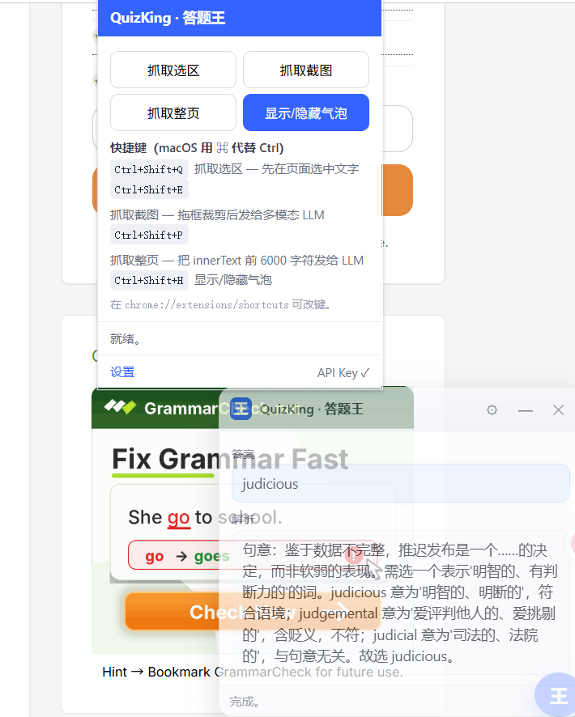
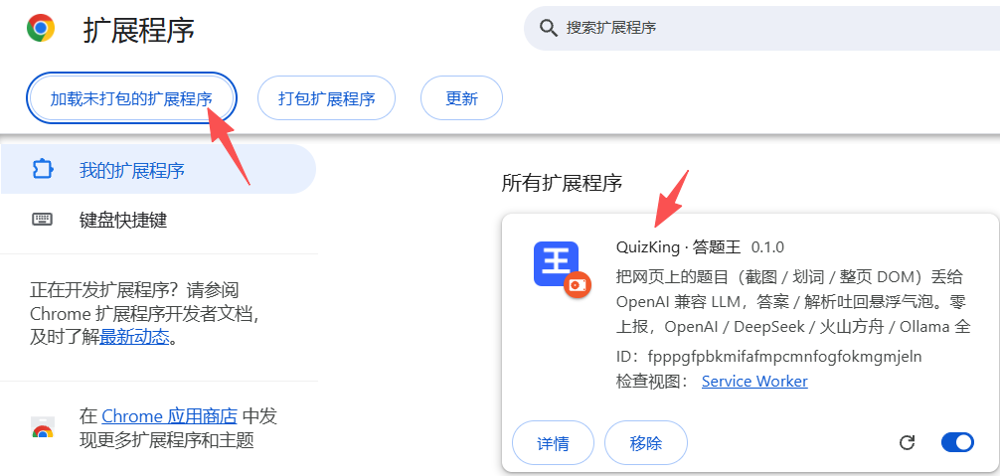
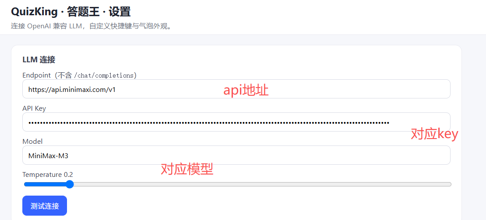
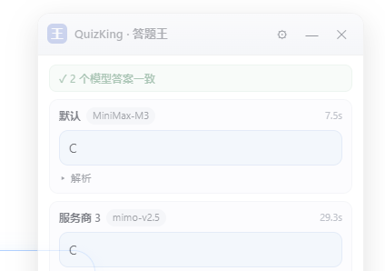
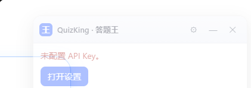
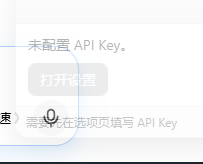
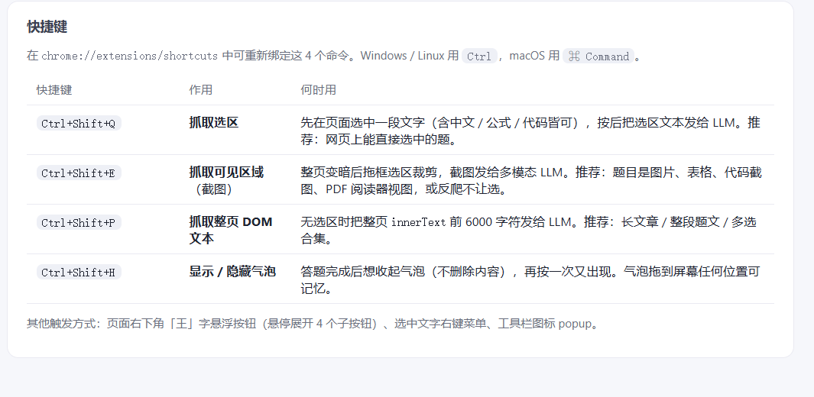
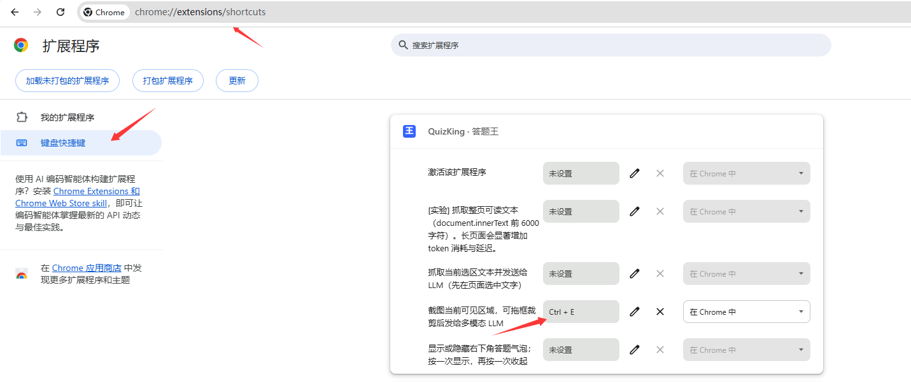

<div align="center">

# QuizKing · 答题王

> 把网页上看到的题目（截图 / 划词 / DOM）丢给 OpenAI 兼容 LLM，把答案 / 解析吐回悬浮气泡。
>
> **本仓库是 [ops120/quizking](https://github.com/ops120/quizking) 的增强版**，基线为其 `main` 分支（v0.3.0，commit `05b6e47`）。原项目的设计、功能、文档与图标全部来自上游，版权归上游作者；本仓库沿用同一个 MIT 许可，只在其之上做了[下面这些改动](#相对上游改了什么)。

[](../../releases)
[](./LICENSE)
[](#技术栈)
[](#安装)
[](#隐私与安全)
[](../../pulls)
[](https://space.bilibili.com/97727630)

</div>

## 目录

- [相对上游改了什么](#相对上游改了什么)
- [特性](#特性)
- [30 秒试用](#30-秒试用)
- [安装](#安装)
- [配置](#配置)
- [使用](#使用)
- [架构](#架构)
- [消息路由](#消息路由)
- [开发](#开发)
- [FAQ](#faq)
- [隐私与安全](#隐私与安全)
- [路线图](#路线图)
- [贡献](#贡献)
- [作者](#作者)
- [许可](#许可)

## 相对上游改了什么

基线：上游 [`ops120/quizking`](https://github.com/ops120/quizking) 的 `main`（v0.3.0，`05b6e47`）。本仓库在其之上做了四块改动，每一块都能复现：

| 方向 | 改了什么 | 细节位置 |
| --- | --- | --- |
| **无痕模式可用**<br>（上游完全没有） | 显式 `"incognito": "spanning"`，让普通窗口与无痕窗口共用同一个 service worker 和同一份配置；气泡在无痕窗口显示「无痕」角标；无痕窗口里点 ⚙ 会自动改在**普通窗口**打开设置页；无痕会话**默认不写入**共享历史（可开）；popup / 选项页显示无痕权限状态并一键跳到扩展详情页开启 | 见下方「无痕模式与受限环境」 |
| **抗页面屏蔽加固** | UI 整体搬进 Shadow DOM（页面 CSS 够不到）+ popover 顶层渲染（任何 z-index 盖不住）；宿主被页面删除后 1 秒内自动挂回且已显示内容不丢；点击统一走 `document_start` 注册的捕获期委托；跨 iframe 收集选区；页面 CSS 强杀、全屏遮罩、事件吞并、猴子补丁四类手法都有实测用例 | 见下方「网页能怎么弄坏插件，以及现在的对策」 |
| **轻量化 / 痕迹收敛** | 页面加载期零动作（配置改为首次抓题才拉取，不再为每个页面唤醒 service worker）；闲置时把宿主节点整体摘除，回到零注入；隐藏标签页不干活；子框架只保留最小监听；移除从未使用的 `scripting` / `notifications` 权限；宿主不再带内联 `style` 属性 | 见下方「轻量化」 |
| **可复现的验证工具** | `tools/` 四个真机脚本 + `_testpage/` 攻击模拟页：主流程 23 项断言、iframe 选区、8 种屏蔽手法矩阵、可检测面三态 | [tools/README.md](./tools/README.md) |

版本沿革：`0.3.0` → `0.3.1`（无痕模式）→ `0.4.0`（抗页面屏蔽）→ `0.4.1`（轻量化与痕迹收敛），逐条见 [CHANGELOG.md](./CHANGELOG.md)。

**已知上限（没有解决的）**：

- 页面**持续**清空 `<body>` 新增节点的写法会让 UI 无法常驻（`_testpage/attacks.html?atk=sweepbody` 可复现；这类页面同时也会删掉它自己的弹层）
- 站点用 `user-select: none` 禁掉选择时，划词通道失效，只能用「抓取截图」
- `chrome://`、扩展商店、PDF 阅读器、其他扩展的页面，浏览器本身禁止注入
- 使用时页面必然能看到 1 个宿主节点——Chrome 没有「显示界面但不产生 DOM 节点」的能力

**明确不做**：把 UI 伪装成页面自带元素、绕过站点的完整性检查或监考管控。理由写在下方「不做『隐身』的原因」。

## 特性

- **三通道采集** — 划词文本 / 整页 DOM 文本 / 可见区域截图 + 框选裁剪
- **多 API 并行对比** — 可配置多个服务商（各自 Endpoint / Key / Model），抓题时同时调用，**谁先返回谁先显示**，答案并列展示并标记是否一致
- **OpenAI 兼容 endpoint** — OpenAI / DeepSeek / 火山方舟 / Ollama 全部可接
- **两种 Prompt 模式** — 答案 + 解析（默认）/ 自定义
- **可拖动悬浮气泡**，可设透明度（0.4–1.0），调低后自动去色淡化、融入页面，ESC 隐藏，⚙ 跳设置
- **多触发方式** — 快捷键 / 右键菜单 / 浮动按钮 / 工具栏 popup
- **本地历史** — 最近 200 条（可关），一键清空
- **无痕模式可用** — 一键跳到扩展详情页开启无痕权限；无痕窗口里设置页自动改在普通窗口打开，无痕会话默认不留历史
- **脏标记** — 选项页改了任何字段都会高亮「● 有未保存的修改」直到点保存
- **零上报** — 不接任何第三方分析 / 统计 / beacon

## 30 秒试用

```bash
# 1. 拉代码（你已经在了）
# 2. Chrome → chrome://extensions/ → 开发者模式 → 加载已解压 → 选 src/
# 3. 工具栏出现「王」字蓝色图标
# 4. 划一段文字 → Ctrl+Shift+Q → 气泡出答案
```

完整配置见 [配置](#配置)。先不填 key 也行，会跳到「未配置 API Key」提示。




## 安装

### 开发者模式（推荐，先跑通）

1. 打开 `chrome://extensions/`
2. 右上角打开「开发者模式」
3. 点「加载已解压的扩展程序」 → 选本仓库 `src/` 目录
4. 工具栏出现「王」字蓝色图标 → 安装成功



> Edge 用户：在 `edge://extensions/` 同理，开发者模式 + 加载已解压。

### 从 Chrome Web Store 安装

> 发布到商店后填入永久链接。

## 配置

1. 工具栏点「王」字图标 → 「设置」打开选项页
2. 在「LLM 连接」点「＋ 添加服务商」，每个服务商填：
   - **名称**：自定义标签（如 `DeepSeek`），气泡里用它标识答案来源
   - **Endpoint**：例如 `https://api.openai.com/v1`（**不要**带 `/chat/completions`，插件自动拼）
   - **API Key**：`sk-...`，存于 `chrome.storage.sync`，不上报
   - **Model**：默认 `gpt-4o-mini`，多模态截图建议 `gpt-4o-mini` / `qwen-vl-max` / `doubao-1.5-vision`
   - **启用**：取消勾选即临时停用，不删配置
   - **Temperature / System Prompt**：所有服务商共用，见下「Prompt 模式」
3. 点单个服务商的「测试」验证连通，或点「测试全部」一次测完
4. 改任何字段都会显示「● 有未保存的修改」 → 点底部「保存」

> 从旧版本升级无需重填：原来的 Endpoint / API Key / Model 会自动迁移为第一个服务商。



### 多 API 并行对比

启用多个服务商后，每次抓题会**同时**向它们发请求（真并发，总耗时约等于最慢的那个），气泡里并列展示各自答案：

| 情况 | 气泡表现 |
| --- | --- |
| 全部一致 | 顶部标 `✓ N 个模型答案一致` |
| 出现分歧 | 顶部标 `⚠ 答案不一致（2/3 一致）`，少数派那张卡加「少数」角标 |
| 某个服务商报错 | 该卡变红显示原因（如 `HTTP 401`），其余答案照常显示 |
| 只启用一个 | 显示与单 API 完全一致，不出现对比标记 |



**结果先后返回，不等最慢的**：发请求是所有服务商并行，但**谁先返回就先画进气泡**——气泡先画出全部服务商的占位卡（标「等待中…」），随后每返回一个就填充一张，状态栏显示「已返回 2/3，等待其余模型…」。一致性徽章也随之逐步更新（等待期间显示灰色 `等待模型返回…`）。所以快模型的结果不用等慢模型。

单个服务商 45 秒无响应会被判定超时（显示「超时（45s 无响应）」），不会让气泡一直转圈。

解析默认折叠，点「解析」展开。注意：图片题会发给**所有**启用的服务商，不支持视觉的模型会报错并显示为失败卡。

### 气泡透明度

选项页「外观与历史」→「气泡透明度」滑块（0.4–1.0）。调低后气泡自动去色淡化；最低档时标题与彩色图标隐藏，只剩浅淡轮廓融入页面：

| 修改前 | 修改后（最低透明度） |
| --- | --- |
|  |  |

### Prompt 模式

| 模式 | system prompt | 气泡显示 |
| --- | --- | --- |
| 答案 + 解析（默认） | 严格 JSON `{answer, reasoning}` | 「答案」+「解析」 |
| 自定义 | 你写的文本 | 按模式判定 |

## 使用

| 快捷键 | 作用 | 何时用 |
| --- | --- | --- |
| `Ctrl+Shift+Q`（macOS `⌘⇧Q`） | **抓取选区** | 先在页面选中一段文字，按后把选中文本发给 LLM。适合：网页上能直接选中的题目。 |
| `Ctrl+Shift+E` | **抓取可见区域**（截图） | 整页变暗后拖框选区裁剪，截图发给多模态 LLM。适合：题目是图片、表格、代码截图、PDF 阅读器、反爬不让选的页面。 |
| `Ctrl+Shift+P` | **抓取整页 DOM 文本** <sub>⚠ 实验</sub> | 把整页 `innerText` 前 6000 字符发给 LLM。适合：长文章、整段题文、多选合集。⚠ **实验性**：长文本会显著增加 token 消耗与延迟；多数场景用「划词」更准。 |
| `Ctrl+Shift+H` | **显示 / 隐藏气泡** | 答题完成后想收起气泡（不丢内容），再按一次又出现。 |

> 在 `chrome://extensions/shortcuts` 可重新绑定这 4 个命令。



**快捷键没反应？** 常见原因是默认组合键在注册时被其他扩展占用（Chrome 会静默跳过，在设置页显示「未设置」），或被输入法 / 常驻软件全局抢占。打开 `chrome://extensions/shortcuts`，点击对应命令右侧的快捷键输入框，直接按下想用的组合键即可，修改即时生效，无需重载扩展：



**其他触发方式**

- 页面右下角悬浮「王」字按钮 → 鼠标悬停展开「选区 / 截图 / 整页 / 气泡」
- 选中文字 → 右键 → 「抓取选区并问 AI」 / 「抓取可见区域并问 AI」 / 「抓取整页 DOM 文本并问 AI」 / 「关闭当前 AI 气泡」
- 工具栏图标 → 弹 popup → 四个按钮（含详细快捷键说明）

## 无痕模式与受限环境

Chrome 出于安全考虑**默认不允许任何扩展在无痕窗口里运行**，而且没有 manifest 开关可以绕过——只能由你在扩展详情页手动允许一次。插件已经把能自动化的部分都做掉了。

**开启（一次性）**

1. `chrome://extensions` → QuizKing「详情」
2. 打开「允许在无痕模式下使用」

也可以从插件里一键跳到那一页：popup 的「开启无痕权限」按钮，或 选项页 →「无痕模式 / 受限环境」→「打开扩展详情页」。

**开启后各通道表现**

| 能力 | 无痕窗口表现 |
| --- | --- |
| 划词 / 截图 / 整页抓取、气泡、无痕角标 | 正常 |
| 4 个快捷键、右键菜单、工具栏 popup | 正常（快捷键要在无痕权限开启后才生效） |
| 服务商 / Prompt / 透明度等配置 | 与普通窗口**共享**（`chrome.storage` 在两处始终共用，不会丢配置） |
| 气泡里的「⚙ 设置」 | 自动改在**普通窗口**打开设置页 |
| 历史记录 | 无痕会话**默认不写入**共享历史，可在选项页打开「无痕会话也保存历史记录」 |

> 为什么设置页不能直接在无痕窗口里打开：默认的 `"incognito": "spanning"` 模式下，Chrome 不允许扩展把自己的页面加载进无痕标签页的主框架。插件检测到无痕窗口后会改用普通窗口打开，而不是安静地失败。

**如果你说的“锁定 / Lockdown”是受管环境**

部分考试或管控环境（如 Respondus LockDown Browser、学校或单位统一下发的受管 Chrome）会在**策略层**直接禁用扩展。这类限制由管理员在浏览器外部下发，插件代码无法也不应该绕过。判断方法：`chrome://extensions` 里插件被禁用且无法启用、或扩展页显示「由贵单位管理」，就是策略封锁。要区分“环境限制”和“插件本身的问题”，按下面的离线自检跑一遍即可。

## 网页能怎么弄坏插件，以及现在的对策

「打开某个网站就用不了」通常是下面这几类手法。每一条都有对策，并且都用 `tools/probe-attacks.mjs` 在真实内核里逐条实测过（改造前 v0.3.0 → 改造后 v0.4.0）：

| 网页手法 | 造成的后果 | 现在的对策 | 结果 |
| --- | --- | --- | --- |
| 页面 CSS 强杀：`#aqh-root{display:none!important}`、`[data-act]{display:none!important}`、`* { … }` | 气泡看不见 / 点不到 | UI 整体搬进 Shadow DOM（页面 CSS 够不到内部）；宿主元素带 inline `!important`，压过页面的 `!important` | 已挡住（改造前被挡） |
| 全屏遮罩抢 `z-index: 2147483647`，并反复把自己后置 | 气泡被盖住、点不到 | 宿主用 popover API 进入**顶层**，任何 z-index 都盖不住它 | 已挡住（改造前被挡） |
| `MutationObserver` + 定时清理，删除注入的节点 | 气泡被删掉 | UI 挂在 `<body>`（注入类 UI 的常规位置，避开「清理 `<html>` 下杂项」的脚本；若 body 链上有 `transform`/`filter` 这类会破坏 fixed 定位的属性，则自动回退挂到 `<html>`）；1 秒心跳自愈，被删后自动挂回且**已显示的内容不丢**；每次抓题前也会补挂一次 | 已挡住（改造前被挡） |
| `window.addEventListener('click', …, true)` 吞掉事件 | 按钮点了没反应 | 内容脚本 `run_at: document_start`，所有 UI 点击走捕获期委托，注册早于页面脚本 | 已挡住（改造前被挡） |
| 页面世界的猴子补丁：改写 `appendChild` / `remove` / `MutationObserver` / `getSelection` | 想让扩展失效 | 内容脚本运行在隔离世界，页面改自己的原型对象影响不到它 | 不受影响 |
| 题目在 iframe 里，顶层文档读不到选区 | 划词抓不到题 | `all_frames: true`；抓选区时向所有帧收选区，取最长的一段回顶层渲染 | 已支持（新增） |
| 页面禁用文字选择（`user-select: none`） | 划词根本选不中 | 无法对抗——这是站点的复制保护，而且对抗它就是帮人破防复制。改用「抓取截图」通道 | 已知限制 |

### 一个真正挡不住的场景

如果页面**持续地**把 `<body>` 里新增的节点全部删掉（`MutationObserver` + 定时器，见 `_testpage/attacks.html?atk=sweepbody`），UI 会在「挂上 → 被删」之间反复循环，你基本看不到气泡。这种页面同时也会删掉它自己的弹窗、下拉、浮层，现实里很少见；真遇到时扩展这边无解。

### 网站能检测到什么（实测）

`tools/probe-detectability.mjs` 站在网站脚本的视角量过，结论是三点：

| 状态 | 页面能观测到的扩展痕迹 |
| --- | --- |
| 页面刚加载完，你没用扩展 | **没有**。没有额外节点、`document.styleSheets` 里没有 `chrome-extension://`、页面世界里没有 `chrome.runtime`、也没有任何全局变量 |
| 气泡显示中 | **1 个节点**：`<div id="aqh-root" popover="manual">`。没有 `style` 属性（样式全在 shadow root 里），`position:fixed`、`z-index:2147483647`、处于顶层 |
| 点 ✕ 关掉气泡 | **回到零**。宿主节点会被整体从页面摘除（对象留在内存里，下次秒开） |

也就是说：**不使用时等于不存在；使用时必然存在一个节点，这一点无法消除**——任何脚本走一遍 DOM 就能看到它，而 Chrome 也没有给扩展提供「在页面里画东西但不留节点」的能力。想彻底不在页面里出现，只有把界面搬到浏览器自己的表面（侧边栏 / popup），那会改变交互方式，属于另一个方向。

### 不做「隐身」的原因

让扩展对页面**隐身**（伪造环境、藏掉节点、绕过观察者、把页面完整性检查糊过去）这件事不做。两个理由：技术上是场必输的军备竞赛，伪装只是把检测门槛抬高一点，却让代码又脆又难维护；方向上，它正是「绕过站点完整性检查」所需要的技术，而绕开考试 / 受管环境的监考管控不在本项目范围内。练题、作业、自测这些场景里，这插件才是它该待的地方。

### 轻量化

- **页面加载期零动作**：不建节点、不起定时器、不发消息（配置改成第一次抓题时才拉取）
- **闲置零节点**：气泡关闭 / FAB 收起后宿主节点整体摘除
- **隐藏标签不干活**：自愈心跳在 `document.hidden` 时直接跳过
- **子框架只留最小逻辑**：点击委托、自愈、配置监听都只在顶层框架注册
- **少了两个没用的权限**：`scripting`、`notifications` 已从 manifest 移除（代码从未使用）
- **没有 `web_accessible_resources`**：网站无法通过 `chrome-extension://` 探测本扩展的资源文件
- **没有远程代码**：无 `eval` / `new Function` / 动态 import，纯 MV3 本地脚本

## 架构

```
┌──────────────────┐    ┌──────────────────┐    ┌──────────────┐
│  popup.html      │    │  background.js   │    │  options.html│
│  (toolbar)       │    │  (service worker)│    │  (settings)  │
└────────┬─────────┘    └────────┬─────────┘    └──────┬───────┘
         │ chrome.runtime        │                       │
         │ .sendMessage          │                       │
         ▼                       ▼                       │
┌─────────────────────────────────────────┐             │
│           content.js (page)              │  ◄──────────┘
│  - capture (selection / visible / page)  │   chrome.storage.sync
│  - bubble UI + FAB                        │   (providers[] /
│  - parseAnswer, showAnswer（多路并列）    │    promptMode /
│  - 一致性标记 / 少数派角标                │    bubbleOpacity / …)
└────────────────────┬────────────────────┘
                     │ chrome.runtime.sendMessage
                     ▼
            background.js 并行扇出（Promise.allSettled，单个失败不阻塞其余）
                ├─ provider A → POST /chat/completions
                ├─ provider B → POST /chat/completions
                └─ provider C → POST /chat/completions
                     │
                     ▼  结果聚合为 items[]，回传气泡并列展示
```

### 文件树

```
QuizKing/
├─ assets/
│  └─ screenshots/                # README 截图
├─ src/                           # 扩展源码（加载这一层即可运行）
│  ├─ manifest.json               # MV3 manifest
│  ├─ background.js               # service worker：命令路由 / LLM HTTP / 存储
│  ├─ content.js                  # 内容脚本：捕获通道 / 气泡 / FAB（样式内联在 Shadow DOM 里）
│  ├─ popup.html / popup.js
│  ├─ options.html / options.css / options.js
│  ├─ _locales/zh_CN/messages.json
│  └─ icons/                      # 16 / 48 / 128 王字 PNG
├─ _testpage/                     # 冒烟测试页（含各种“屏蔽扩展”手法的模拟页）
├─ tools/                         # 真机验证脚本（见 tools/README.md）
├─ .github/
│  ├─ ISSUE_TEMPLATE/             # bug / feature 模板
│  └─ PULL_REQUEST_TEMPLATE.md
docs/  .doc/                      # 本地文档（已在 .gitignore，不随仓库发布）
├─ .editorconfig
├─ .gitignore
├─ FAQ.md
├─ LICENSE
├─ README.md
└─ SECURITY.md
```

## 消息路由

`background.js` 暴露以下 `chrome.runtime.onMessage` 入口：

| type | 行为 | 返回 |
| --- | --- | --- |
| `aqh/get-config` | 读 storage，逐条剥离 `apiKey` | `{ ok, cfg, hasKey }` |
| `aqh/capture-visible-tab` | `chrome.tabs.captureVisibleTab` | `{ ok, dataUrl }` |
| `aqh/ask` | 立即回执服务商名单，随后并行调用 + 增量推送结果 | `{ ok, result: { reqId, pending[], promptMode } }` |
| `aqh/test` | 仅探测 storage 状态 | `{ ok, cfg, hasKey, providerCount }` |
| `aqh/selftest` | 默认关闭，需 `self.__AQH_SELFTEST__ = true` | `{ ok, cfg, routes, flags }` |

`aqh/ask` 的结果不走响应体，而是由 background 主动推送（`chrome.tabs.sendMessage`）：

| 推送 type | 时机 | payload |
| --- | --- | --- |
| `aqh/ask-item` | 每有一个服务商返回或失败 | `{ reqId, item }` |
| `aqh/ask-finish` | 全部落定 | `{ reqId, items[], promptMode }` |

> 内部协议命名空间为 `aqh/`（保持稳定，便于第三方工具集成）。

`content.js` 自己处理：

| type | 行为 |
| --- | --- |
| `aqh/capture` | 触发 selection / visible / page / toggle |
| `aqh/close` | 关闭气泡 |
| `aqh/ping` | 探活 |

## 开发

### 本地运行

```bash
# 1. 改 src/ 下的代码
# 2. chrome://extensions/ → QuizKing → ♻ 重新加载
# 3. 普通网页 F12 → console 看 [aqh] 调试日志
# 4. SW DevTools: chrome://extensions → "service worker" 链接 → console
```

### 静态检查

```bash
node --check src/*.js
node -e "JSON.parse(require('fs').readFileSync('src/manifest.json','utf8'))"
node -e "JSON.parse(require('fs').readFileSync('src/_locales/zh_CN/messages.json','utf8'))"
```

### 调试 Hook

```js
// SW DevTools console
self.__AQH_SELFTEST__ = true;
chrome.runtime.sendMessage({ type: "aqh/selftest" }, console.log);
// → { ok: true, cfg, routes, flags }
```

不依赖 LLM 网络 —— 用于离线核对 wiring 是否就绪。

### 重新生成图标

`src/icons/icon.svg` 是唯一源。生成 16/48/128 PNG：

```bash
NODE_PATH=./_icontools/node_modules node -e "
const sharp = require('sharp');
const fs = require('fs');
const svg = fs.readFileSync('src/icons/icon.svg');
(async () => {
  for (const s of [16, 48, 128]) {
    fs.writeFileSync('src/icons/icon' + s + '.png',
      await sharp(svg, { density: 300 }).resize(s, s).png().toBuffer());
  }
})();
"
```

## FAQ

最常见问题看 [FAQ.md](./FAQ.md)。**先查 FAQ 再开 issue**。

## 隐私与安全

- **API Key** 只存于 `chrome.storage.sync`，永不上报
- **fetch 出站** 只去用户在设置里填的 `endpoint`（多服务商时即你启用的那几个），**没有**其他任何外发
- **history** 仅写 `chrome.storage.local`，默认保存最近 200 条，可在选项页关闭 / 清空
- **content 脚本**永远拿不到 `apiKey`（`sanitizeCfg` 逐条剥离后回传）
- **控制台日志** 只输出长度统计 / 通用错误消息，**不含**用户文本或 key
- 安全问题不要开 public issue，按 [SECURITY.md](./SECURITY.md) 流程报告

### Manifest 权限

| 权限 | 用途 |
| --- | --- |
| `storage` | 读 / 写 `chrome.storage.sync` & `.local` |
| `activeTab` | popup 获取当前 tab id |
| `contextMenus` | 注册右键菜单 |
| `host_permissions: <all_urls>` | content 脚本注入任意页以捕获内容；`tabs.captureVisibleTab` 截图也依赖它 |

> `host_permissions` 仅用于 content 注入与截图；不出站。
> 早期版本声明过 `scripting` / `notifications`，但代码从未使用，已移除。

## 路线图

- [ ] 选择 / 判断 / 填空的结构化答案注入
- [ ] 题型 Prompt 模板库（数学 / 编程 / 英语 / 医学）
- [ ] 站点规则：每个域名可独立 prompt + 模型
- [ ] 本地 OCR 引擎（Tesseract.js）作为非视觉模型 fallback
- [ ] Firefox 适配
- [ ] Chrome Web Store 发布

## 贡献

欢迎 fork & PR：

1. Fork & 创建分支
2. `node --check src/*.js` 通过
3. 自测：在 `chrome://extensions` 重载扩展后，用「划词 / 截图 / 整页」三条通道各抓一题，确认气泡出答案
4. 提 PR，附带：改了什么 / 为什么 / 怎么验证 / 风险点
5. 维护者审 → 合入

## 作者与上游

- **上游项目 / 原作者**：[ops120/quizking](https://github.com/ops120/quizking)，B 站 [97727630](https://space.bilibili.com/97727630)。本仓库的原始设计、核心功能、文档与图标全部来自这里。
- **本仓库**：上游的增强分支。上游的问题反馈 / 合作 / 教程请求请找上游作者；本仓库改动相关的问题请在本仓库开 Issue。


## 致谢

- [ops120/quizking](https://github.com/ops120/quizking) — 本仓库的上游项目
- [linux.do](https://linux.do/) — 中文独立技术社区，给了工具 / 思路上的大量启发与反馈

## 许可

[MIT](./LICENSE) — 自由使用、修改、分发。

上游版权归上游仓库的 `AI Quiz Helper Contributors` 所有；本仓库与上游使用同一个 MIT 许可，[LICENSE](./LICENSE) 中同时保留上游版权声明与本仓库改动部分的版权声明。

---

<div align="center">

Made with care for students, self-learners, and anyone staring at quiz screenshots at 2 a.m.

</div>
